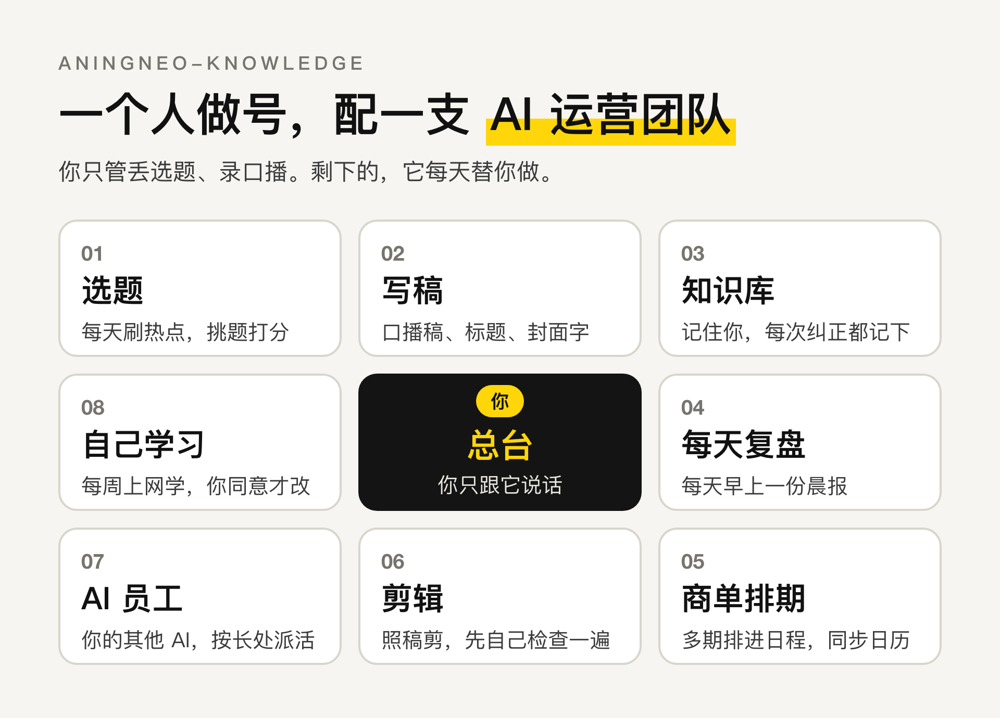
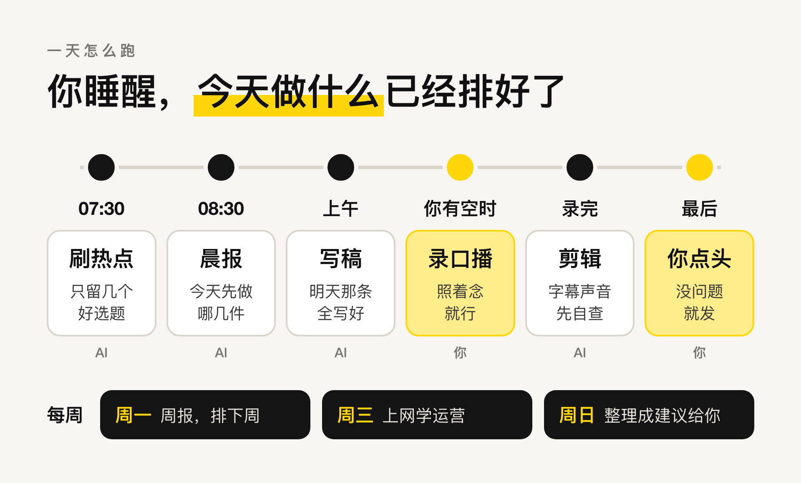
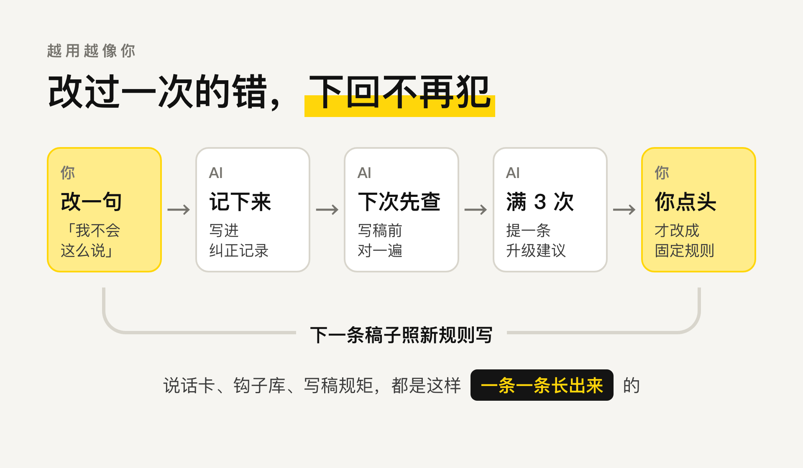
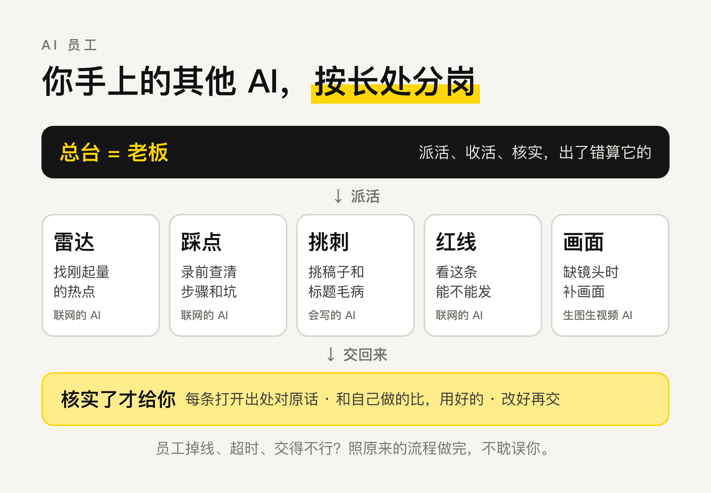
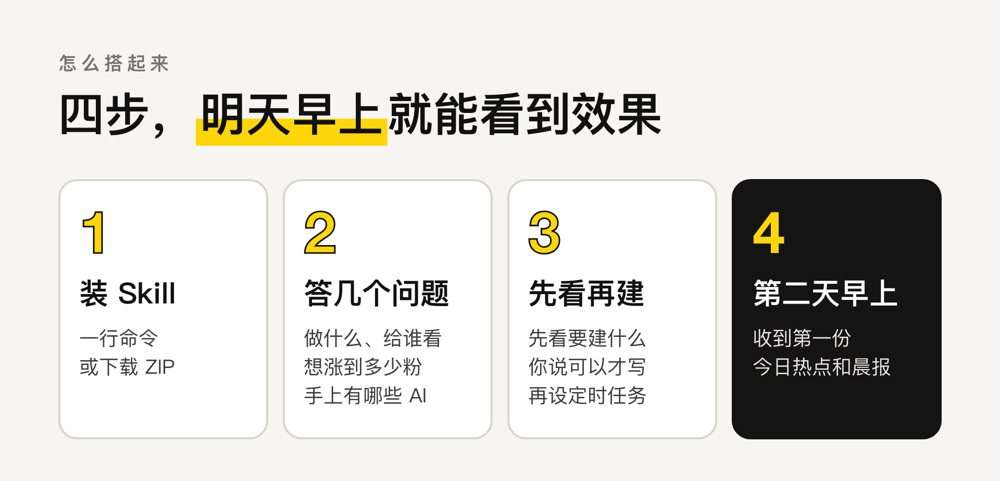

# aningneo-workbench

**一个人做自媒体，也能有一支 AI 运营团队。**

一个装进 Claude Code、Codex、WorkBuddy 就能用的 Skill。它带你在自己电脑上搭一个自媒体工作台：每天刷热点挑选题、写好稿子、早上出晨报、排商单、照稿剪辑并自检，还会把你手上的其他 AI 安排起来，越用越像你。

[⬇ 下载最新版](https://github.com/8533502-dev/aningneo-workbench/releases/latest) ｜ [📂 打开 Skill 目录](skills/aningneo-workbench/) ｜ [怎么搭起来](#怎么搭起来)



## 这是什么

一个人做号，选题、写稿、剪辑、看数据全是自己来，做着做着就累了。

这个 Skill 带你在自己电脑上搭一个工作台。它不只是一个工具，更像一个运营团队，员工都是 AI。中间有个「总台」，你只跟它说话；它带着团队每天替你干活。你要做的只剩两件：看到好选题丢给它，把口播录好。

## 搭好以后，每天会发生什么



- **早上 7 点半**，它已经把几个平台的热点刷完了，一大堆里只留下几个，每个都写好为什么会火、从哪个角度讲、值几分。火了超过 5 天的，它不选。
- **8 点半**，晨报出来了：离你定的涨粉目标还差多少，昨天哪条涨了粉、哪条没什么人看，下一条该怎么改，今天先做哪三件。
- **明天发哪条**，它自己定好，口播稿、标题、封面字、评论区第一条都写完了。你照着念就行。
- **录完丢给它**，它照着稿子剪，剪完先自己查一遍字幕有没有错、声音大不大，有问题自己改掉，再给你看。
- **每周**，周一出周报排下周，周三上网学新的运营方法，周日整理成建议，你同意了它才改。

## 它能替你做的 8 件事

| | 功能 | 它替你做什么 |
| --- | --- | --- |
| 1 | 选题 | 每天定时刷多平台热点，挑题、打分，过气的不选 |
| 2 | 写稿 | 定明天发哪条，写好口播稿、标题、封面字、评论区第一条 |
| 3 | 知识库 | 记住你是谁、怎么说话；你纠正一次它记一条；你没用过的工具先问你 |
| 4 | 每天复盘 | 盯着你定的目标看粉丝数，每天早上一份晨报 |
| 5 | 商单排期 | 一单好几期，录制、交审、发布排进日程，同步到日历；记着竞品期 |
| 6 | 剪辑 | 照稿剪口播，自己先查字幕和声音，再给你看 |
| 7 | AI 员工 | 把你手上其他 AI 按长处分岗，核实过才交给你 |
| 8 | 自己学习 | 每周上网学运营，整理成建议，你点头才改规则 |

## 越用越像你



AI 写的稿子刚开始总有股 AI 味，你改了一句，它下回还犯。所以每次你纠正，它都当场记一条。下次写稿先翻一遍。同一类错到第 3 次，它就提一条建议，把它写成固定规则——你同意了才改。

你的说话习惯、好用的开头、自己账号的规律，就是这样一条一条长出来的。

## 你手上的其他 AI，也能派上用场



很多人手上不止一个 AI。能联网搜索的，可以去找热点、录之前查清步骤和坑、看一条内容能不能发；会写的可以挑稿子和标题的毛病；能生图生视频的，剪辑缺镜头时补画面。

总台当老板：派活、收活、打开出处核对。核实过才给你，出了错算总台的。员工掉线也不耽误，它照原来的流程做完。没有别的 AI 也没关系，这些岗位总台自己做。

## 怎么搭起来



**1. 装 Skill**

```bash
npx -y skills@latest add 8533502-dev/aningneo-workbench --skill aningneo-workbench -y
```

不用命令行的话，去 [Releases](https://github.com/8533502-dev/aningneo-workbench/releases/latest) 下载 ZIP，解压后把 `aningneo-workbench` 文件夹放进 Agent 的 Skill 目录。

**2. 把这段话发给你的 Agent**，它会接着问你缺的信息：

```text
用 aningneo-workbench 帮我搭一个自媒体工作台，放在「这里换成文件夹路径」。
我做的是「什么内容」，现在大概「N」粉，想在「多久」涨到「N」粉。
我手上有这些 AI 和工具：「列出来」。我用的是「Claude Code / Codex / WorkBuddy」。
先问我缺的信息，再给我看要建哪些文件，我说可以了再建。建好以后帮我把定时任务设好。
```

**3. 先看再建**：它会先列出要建哪些文件，你说可以才写；已有的文件一个都不动。然后帮你把每天、每周的定时任务设好，每个任务花不花钱都会先说。

**4. 第二天早上**，打开工作台，第一份今日热点和晨报已经在里面了。之后日常就这样说：

```text
今日热点
这个题帮我写成明天发的稿子
出今天的晨报
接了个商单，三期，帮我排进日程，同步日历
D003 的口播录好了，帮我剪
看看待升级
```

## 哪些是起步版，要你自己长

这个 Skill 给的是能跑起来的骨架、流程、模板和检查表，照着做就能出稿、剪片。下面这些每个账号都不一样，故意留空：

- 你的说话卡、好用的开头、爆款规律：由你的纠正记录和发布数据慢慢长出来
- 剪辑风格（字体、配色、动效、配乐）：剪过几条、知道自己喜欢什么再定
- 各个 AI 员工的具体提示词：按你手上的工具自己写、自己调

想按自己的账号把整套定制好（网页看板、剪辑风格、员工接入等），可以在仓库提 Issue 联系作者。

## 花钱和密钥

- Skill 本身免费。抓数据、生图生视频、语音转写这类按次收费的接口，你自己开通、自己付钱；每次开跑前它都先报价，你同意才跑。长期的小额授权（比如「每天 5 次以内直接抓」）会记下来，超了就停下来问你。
- 不想花钱也能跑：热点用网页搜索和公开榜单，粉丝数用你每天发的后台截图，字幕用本地免费的 Whisper 类工具。
- 密钥只放环境变量或系统钥匙串，不写进工作台文件，也不在这个仓库里。

## 能在哪些 Agent 里用

| Agent | 定时任务怎么跑 |
| --- | --- |
| Claude Code | 用 `claude -p` 加系统定时（cron / launchd / 任务计划），或在会话里循环 |
| Codex | 用 `codex exec` 加系统定时 |
| WorkBuddy | 有自动化功能就填进去；没有就每天早上说一句「跑今天的热点和晨报」 |

剪辑用到的脚本要装 `ffmpeg`，其余只用 Python 3 自带的库。详细步骤看 [使用说明](skills/aningneo-workbench/README.md)。

---

## 它守的规矩

- 先给方案，你说可以再动手：写文件前先预览，花钱前先报价。
- 你的原始文件只读不改，产出另存。
- 员工交回来的东西，总台核实过才给你；分清「原文写的」「别人说的」「AI 总结的」。
- 用了第三方服务就明说，不包装成自己的能力。

## 其他

作者：阿宁Neo · [@8533502-dev](https://github.com/8533502-dev)
更新记录见 [CHANGELOG](CHANGELOG.md)，下载包见 [Releases](https://github.com/8533502-dev/aningneo-workbench/releases)。
许可：[MIT](LICENSE)
